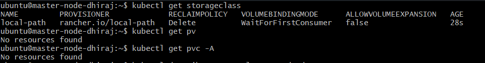
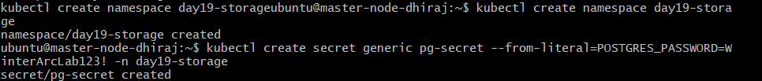
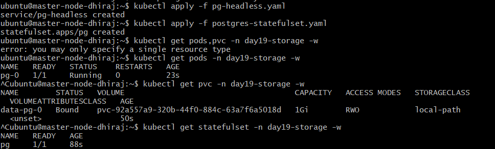
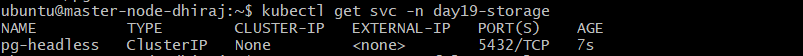
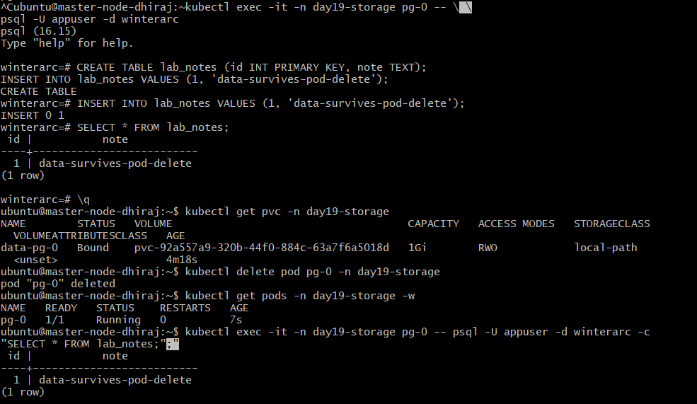
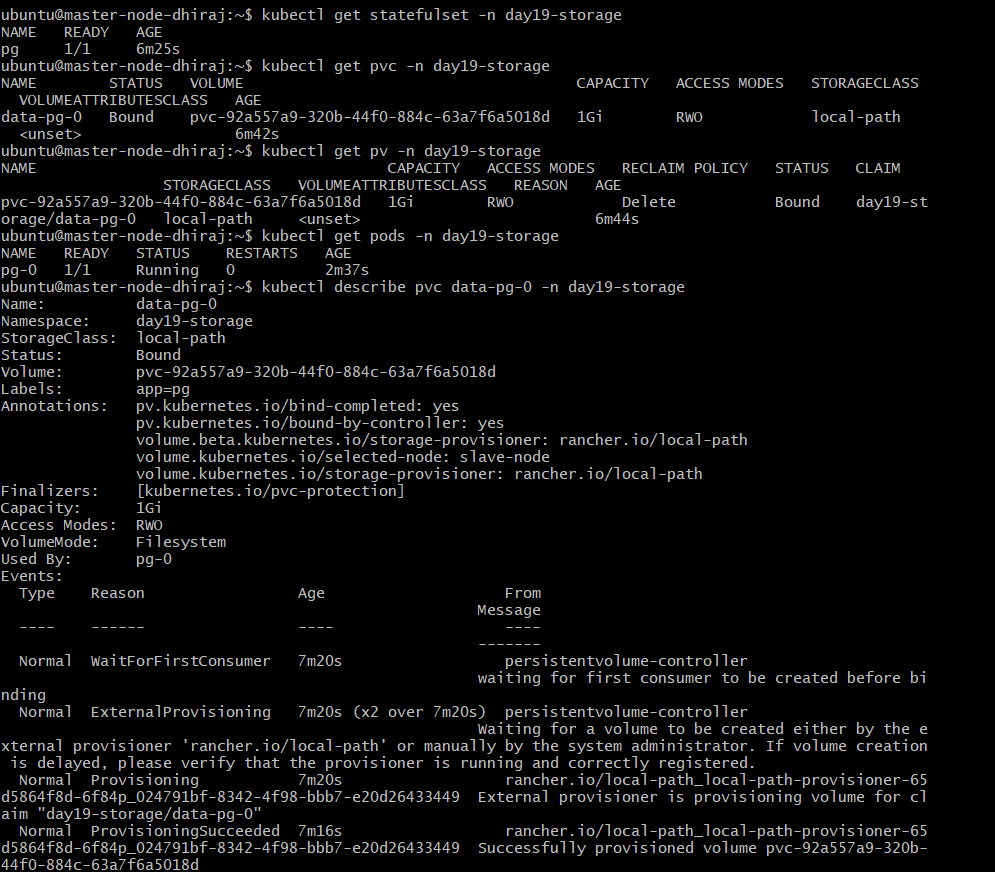
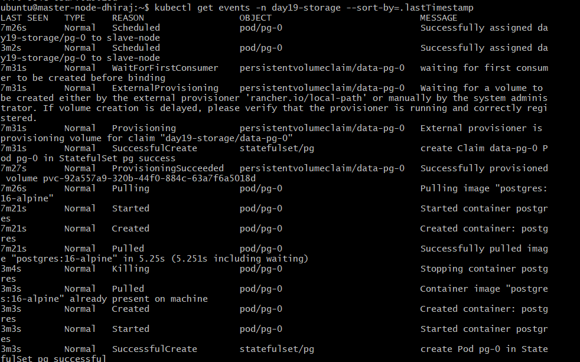
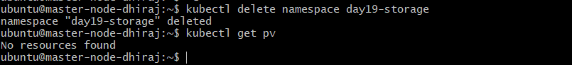

# Day 19: Storage & StatefulSets — Durable Database Storage in Kubernetes

> **DevOps Winter Arc — 90 Days Challenge | Week 3: Kubernetes**  
> **Mission:** Keep a database record alive even after its Pod is deleted by configuring persistent storage, claims, and stateful workloads.

---

## 📌 Executive Summary

In containerized environments, container filesystems are ephemeral: when a Pod terminates or crashes, any data written to its writable layer is permanently lost. To run stateful applications (such as PostgreSQL, MySQL, Redis, or MongoDB) reliably in Kubernetes, storage must be decoupled from the Pod lifecycle.

In this hands-on lab, we deployed a **PostgreSQL database using a Kubernetes StatefulSet**, connected it to a **Headless Service** for stable network identity, dynamically provisioned persistent storage via **PersistentVolumeClaims (PVC)**, and proved that database records survive complete Pod destruction and recreation.

---

## 🏗️ Storage Chain & Component Architecture

Understanding how Kubernetes connects stateful workloads to physical disk storage requires mapping the four key components:

```
+---------------------------------------------------------------------------------+
|                                StatefulSet: pg                                  |
|  +---------------------------------------------------------------------------+  |
|  | Pod: pg-0                                                                 |  |
|  |  - Container: postgres:16-alpine                                          |  |
|  |  - Volume Mount: /var/lib/postgresql/data                                 |  |
|  +---------------------------------------------------------------------------+  |
|                                         |                                       |
|                                volumeClaimTemplates                             |
+---------------------------------------------------------------------------------+
                                          |
                                          v
+---------------------------------------------------------------------------------+
| PVC: data-pg-0 (Namespace: day19-storage)                                       |
|  - Request: 1Gi | AccessMode: ReadWriteOnce | StorageClass: local-path          |
+---------------------------------------------------------------------------------+
                                          | Dynamic Provisioning
                                          v
+---------------------------------------------------------------------------------+
| StorageClass: local-path (Provisioner: rancher.io/local-path)                   |
+---------------------------------------------------------------------------------+
                                          | Creates & Binds
                                          v
+---------------------------------------------------------------------------------+
| PV: pvc-92a557a9-320b-44f0-884c-63a7f6a5018d (Capacity: 1Gi, Reclaim: Delete)   |
|  - Node Host Path: /var/lib/rancher/k3s/storage/...                               |
+---------------------------------------------------------------------------------+
```

1. **PersistentVolume (PV):** A resource in the cluster representing physical storage on a node or cloud provider (e.g., EBS, NFS, local directory).
2. **PersistentVolumeClaim (PVC):** A request for storage by a user/workload specifying size (`1Gi`) and access modes (`ReadWriteOnce`).
3. **StorageClass:** Defines the storage provisioner (`rancher.io/local-path`) that dynamically creates the PV when a PVC is submitted.
4. **StatefulSet:** A workload controller that manages Pods with sticky identity (e.g., `pg-0`), binding each Pod to its dedicated PVC via `volumeClaimTemplates`.
5. **Headless Service (`clusterIP: None`):** Provides direct DNS resolution for individual Pods rather than load balancing across a single virtual IP.

---

## 🚀 Step-by-Step Task Execution & Verification

### Task 1: Cluster Inspection & StorageClass Verification

First, inspect the available StorageClass in the cluster and check existing volumes.

```bash
# Verify cluster StorageClass, PVs, and PVCs across all namespaces
kubectl get storageclass
kubectl get pv
kubectl get pvc -A
```



---

### Task 2: Create Namespace and Secret

Create a dedicated namespace and dummy database password Secret.

```bash
# Create dedicated namespace
kubectl create namespace day19-storage

# Create lab secret for PostgreSQL password
kubectl create secret generic pg-secret \
  --from-literal=POSTGRES_PASSWORD=WinterArcLab123! \
  -n day19-storage
```



---

### Task 3 & 4: Deploy Headless Service & PostgreSQL StatefulSet

Create `pg-headless.yaml` and `postgres-statefulset.yaml` to deploy the stateful workload and bind storage dynamically.

```bash
kubectl apply -f pg-headless.yaml
kubectl apply -f postgres-statefulset.yaml
kubectl get pods -n day19-storage -w
kubectl get pvc -n day19-storage -w
kubectl get statefulset -n day19-storage -w
```




---

### Task 5: Test Data Persistence Across Pod Deletion

1. **Connect to PostgreSQL and insert a test record:**

```bash
kubectl exec -it -n day19-storage pg-0 -- psql -U appuser -d winterarc
```

Execute SQL queries:
```sql
CREATE TABLE lab_notes (id INT PRIMARY KEY, note TEXT);
INSERT INTO lab_notes VALUES (1, 'data-survives-pod-delete');
SELECT * FROM lab_notes;
\q
```

2. **Simulate Pod Failure by deleting `pg-0` and verifying recovery:**

```bash
kubectl delete pod pg-0 -n day19-storage
kubectl get pods -n day19-storage -w
kubectl exec -it -n day19-storage pg-0 -- psql -U appuser -d winterarc -c "SELECT * FROM lab_notes;"
```

**Result:** The query returned `1 | data-survives-pod-delete`. Data successfully persisted despite Pod destruction!



---

### Task 6-1: Storage Chain Inspection & PVC Describe

Examine PVC details, bound PV name, and storage components.

```bash
kubectl get statefulset -n day19-storage
kubectl get pvc -n day19-storage
kubectl get pv -n day19-storage
kubectl describe pvc data-pg-0 -n day19-storage
```



---

### Task 6-2: Storage Provisioning & Scheduling Events

Check cluster lifecycle and scheduling events sorted by timestamp.

```bash
kubectl get events -n day19-storage --sort-by=.lastTimestamp
```



---

### Task 7: Cleanup & Teardown

To tear down all lab resources and delete the namespace:

```bash
kubectl delete namespace day19-storage
kubectl get pv
```



---

## 🔍 Diagnostics & Troubleshooting Matrix

| Symptom / Issue | Potential Cause | Investigation & Remediation |
| :--- | :--- | :--- |
| **PVC remains in `Pending` state** | 1. Invalid `storageClassName`<br>2. Storage provisioner offline<br>3. Unsatisfied capacity requests | Run `kubectl describe pvc <pvc-name>`. Verify available StorageClass names via `kubectl get sc`. |
| **Pod in `CrashLoopBackOff`** | 1. Incorrect Secret keys<br>2. Permissions issue on mount path<br>3. Missing database env vars | Check logs using `kubectl logs pg-0 -n day19-storage`. Verify Secret key matches `POSTGRES_PASSWORD`. |
| **Data missing after Pod restart** | Mount path mismatch in container | Ensure `volumeMounts.mountPath` matches official DB directory (`/var/lib/postgresql/data` for Postgres). |
| **PVC retained after Pod delete** | Default Kubernetes behavior | Working as designed. Deleting a Pod or StatefulSet does NOT delete PVCs automatically to prevent data loss. |

---

## ❓ Interview Readiness — Architecture & Technical Q&A

### Q1. What is the difference between a PV and a PVC?
- **Answer:** A **PV (PersistentVolume)** is an actual cluster-level storage volume provisioned manually or dynamically. A **PVC (PersistentVolumeClaim)** is a user's request for storage with specific capacity and access mode requirements. Kubernetes binds claims to matching PVs.

### Q2. Why should database files never be stored on a container's writable layer?
- **Answer:** A container's writable layer is ephemeral and tightly coupled to the container runtime instance. If a container crashes, restarts, or moves to another node, all data on that layer is permanently destroyed. Persistent storage outlives container lifecycles.

### Q3. What is the role of a StorageClass in Kubernetes?
- **Answer:** A `StorageClass` provides a way for administrators to describe the "classes" of storage offered. It specifies the volume provisioner (e.g., AWS EBS, local-path) and parameters used to dynamically provision `PersistentVolumes` when a `PVC` is requested.

### Q4. What does `volumeClaimTemplates` do inside a StatefulSet manifest?
- **Answer:** Unlike Deployments where pods share volume definitions, `volumeClaimTemplates` automatically creates a distinct PVC for each Pod replica created by the StatefulSet (e.g., `data-pg-0`, `data-pg-1`). This gives each Pod instance its own dedicated persistent storage volume.

### Q5. Why did our PostgreSQL database data survive after running `kubectl delete pod pg-0`?
- **Answer:** Deleting the Pod `pg-0` destroyed only the stateless container compute instance. The underlying PVC (`data-pg-0`) and bound PV remained intact. When the StatefulSet controller recreated `pg-0`, it reattached the existing PVC to the new Pod container mount path.

### Q6. Compare Kubernetes Deployments vs. StatefulSets.
- **Answer:** 
  * **Deployment:** Best for stateless workloads. Pods have random hostnames, are interchangeable, and share identical storage specs.
  * **StatefulSet:** Best for stateful workloads. Pods receive deterministic ordinal names (`pg-0`, `pg-1`), ordered deployment/scaling guarantees, and unique per-pod persistent volume claims.

### Q7. What does the `ReadWriteOnce` (RWO) access mode mean?
- **Answer:** `ReadWriteOnce` means the volume can be mounted as read-write by a **single node** at a time. Multiple Pods running on the *same node* may access it depending on storage driver capabilities, but Pods across different nodes cannot.

### Q8. Why is a Headless Service (`clusterIP: None`) required for StatefulSets?
- **Answer:** Stateful applications (like database clusters requiring primary/replica setups) need to address specific individual instances directly. A Headless Service creates direct A/AAAA DNS records for each Pod hostname (e.g., `pg-0.pg-headless`) instead of load balancing across a single virtual ClusterIP.

### Q9. What are two common reasons a PVC stays in `Pending` state?
- **Answer:** 
  1. The requested `storageClassName` does not exist in the cluster or is misspelled in the manifest.
  2. The underlying dynamic provisioner driver is failing or unavailable on the host nodes.

### Q10. Does deleting a StatefulSet automatically delete its PVCs?
- **Answer:** No. By default, deleting a StatefulSet or deleting individual Pods does not delete the associated PVCs. This safety mechanism prevents accidental loss of critical persistent data.

### Q11. What risk is involved when deleting a PVC directly?
- **Answer:** Depending on the `reclaimPolicy` of the bound PV (`Delete` vs. `Retain`), deleting a PVC can trigger the immediate deletion of the underlying PV and physical data from the storage provider.

### Q12. Is Kubernetes persistent storage equivalent to a backup system?
- **Answer:** No. Persistent storage provides high availability and durability against container/node crashes, but it does not protect against data corruption, bad SQL queries, or site-level disasters. Automated snapshot backups and disaster recovery protocols are still required.

---

## 🏆 Mini-Challenge Verification Checklist

- [x] Cluster `StorageClass` verified (`local-path`).
- [x] Dedicated namespace `day19-storage` created.
- [x] Generic Secret `pg-secret` configured.
- [x] Headless Service `pg-headless` active (`clusterIP: None`).
- [x] PostgreSQL StatefulSet `pg-0` initialized and `Bound` to PVC `data-pg-0`.
- [x] Database table created and test record inserted.
- [x] Pod `pg-0` deleted and automatically recreated by StatefulSet controller.
- [x] Data persistence verified via post-recreation SQL query.
- [x] Namespace clean teardown performed.